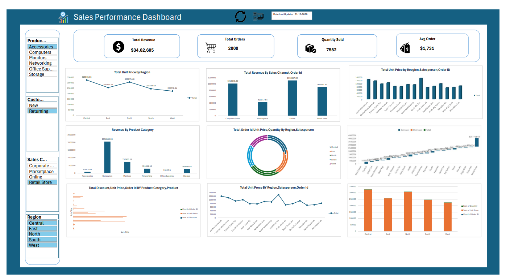

# 📊 Sales Performance Dashboard | Excel

An interactive Sales Performance Dashboard built using Microsoft Excel to analyze sales performance, revenue trends, customer behavior, and regional performance.

## 🎯 Project Overview

This project transforms raw sales data into meaningful business insights through an interactive dashboard with KPI cards, PivotTables, PivotCharts, and slicers.

## 📌 Key Performance Indicators

| KPI | Value |
|---|---:|
| Total Revenue | $3,462,605.32 |
| Total Orders | 2,000 |
| Quantity Sold | 7,552 |
| Average Order Value | $1,731.30 |

## 📈 Dashboard Features

- Revenue analysis by product category
- Sales performance by region
- Sales channel analysis
- Customer segmentation
- Product category filtering
- Interactive dashboard filters and slicers
- KPI-based performance monitoring

## 🛠️ Tools & Technologies

- Microsoft Excel
- PivotTables
- PivotCharts
- Excel Slicers
- Data Analysis
- Data Visualization

## 📂 Project Files

- `Sales_Performance_Dashboard.xlsx` – Excel dashboard and workbook.
- `Sales_Performance_Dashboard.pdf` – PDF preview of the dashboard.

## 💡 Business Value

The dashboard helps users monitor key sales metrics, compare regional and product performance, and explore sales data through interactive filters.

## 👨‍💻 Author

**Kaustubh Pawar**

GitHub: https://github.com/kaustubh-pawar-dev
